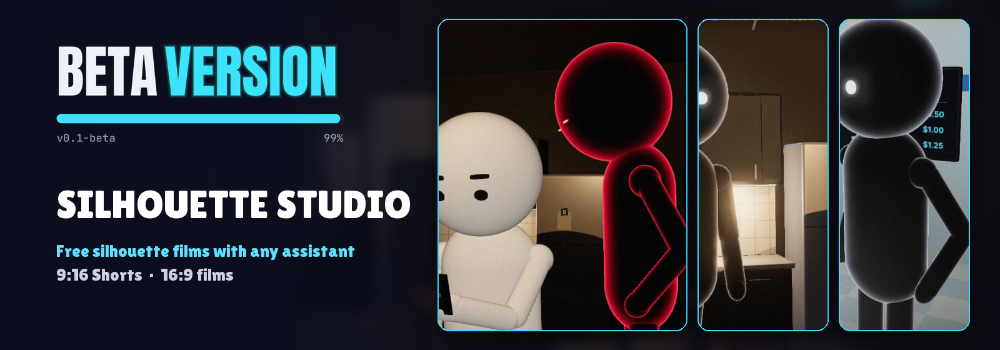

<div align="center">




# Beta Version Silhouette Studio

**Turn a story into a voiced, scored silhouette animation film (16:9 or 9:16). Just ask your AI assistant: no installs, no editing.**

[](LICENSE.md)
[](skill/SKILL.md)
[](https://threejs.org/)
[](https://www.instagram.com/beta_versionhq/)
[](https://www.youtube.com/@BetaVersion_HQ)
[](https://github.com/BetaVersionHQ/beta-version-silhouette-studio/stargazers)
[](https://github.com/BetaVersionHQ/beta-version-silhouette-studio/releases/latest)

### **📣 Like it? Follow [@beta_versionhq on Instagram](https://www.instagram.com/beta_versionhq/) and subscribe on [YouTube @BetaVersion_HQ](https://www.youtube.com/@BetaVersion_HQ) for new tools and updates.**

</div>

---

## 🎬 See it in action

https://github.com/user-attachments/assets/de534182-9b27-41af-b979-00cb8f546e03

<div align="center"><sub>Every clip above was made with this kit: the two starter films, Kokoro voices, rendered on a laptop GPU.</sub></div>

---

## 📺 Watch the full walkthrough

<div align="center">

<a href="https://youtu.be/2lWpsqjfau4" title="Make Animated Films Like This for Free (Beginner Setup, No Coding)">
  
</a>

**▶️ [Make Animated Films Like This for Free (Beginner Setup, No Coding)](https://youtu.be/2lWpsqjfau4)**: setup and a full film, start to finish.

</div>

---

## Start here: no installs

Never used a terminal? Open an AI coding assistant (Claude Code, Codex CLI, Gemini CLI, Antigravity, Cursor) and paste:

```
Set up this film studio for me: https://github.com/BetaVersionHQ/beta-version-silhouette-studio — download it, install anything that's missing, and make the 10-second test film.
```

It installs Python, Node and ffmpeg if needed, sets up the studio and makes a test film. More prompts and the list of
assistants that work: [docs/START_HERE.md](docs/START_HERE.md). The agent follows [AGENTS.md](AGENTS.md).

---

## What it is
A small film studio in code. You write the story in one Python file (lines, emotions, marks, date chips). The kit then:
- **voices** every line with Kokoro-82M (free, local, Apache-2.0),
- **stages** glowing-eyed silhouette figures in a three.js set (walks, sits, looks, talk motion from the voice),
- **cuts** the camera automatically (speaker singles, wides, clean framing in both 16:9 and 9:16),
- **scores and sound-designs** it procedurally (footsteps from the animation, doors, rooms, rain, piano and strings),
- **checks** it with a QA gate (feet, walls, speed, framing, dates, voices) before anything renders,
- **renders** an mp4 at 30 fps with the browser's GPU, or on the CPU if there is none.

No paid APIs, no cloud, no sample packs.

## Prefer the terminal? (3 commands)
```bash
python kit/setup.py                                # installs everything, detects your render tier
python kit/new_film.py myfilm --format short       # copies a starter film to films/myfilm
python kit/make.py films/myfilm all                # build, voice, sound, qa, render -> films/myfilm/out/myfilm.mp4
```
Needs Python 3.10+, Node 18+ and ffmpeg on PATH. Details and troubleshooting: [SETUP.md](SETUP.md).
Try `--seconds 10` on the last command for a quick first render.

## With an AI assistant
Any coding agent that can run commands on your computer works: it reads [AGENTS.md](AGENTS.md)
(Claude Code via CLAUDE.md, Gemini CLI via GEMINI.md, Codex, Antigravity and Cursor via AGENTS.md). Built and tested with
Claude Code; the others follow the same plain instructions but are not tested yet. In Claude Code the skill loads by itself
when you open this folder. Then just ask: *"Make a 90-second silhouette short about two brothers fixing an old radio."*

## Render tiers
`kit/setup.py` picks the tier by testing what WebGL actually runs on; `--tier` or `TIER=` overrides it.

| Tier | What it uses | Rough speed (720p, 30 fps) | 1-minute film |
|---|---|---|---|
| `GPU` | NVIDIA GPU through installed Chrome or Edge | ~45 frames/s (laptop RTX 5070) | ~40 s |
| `ANYGPU` | any other GPU (Intel, AMD, Apple) through Chrome or Edge | usually 15-40 frames/s | 1-2 min |
| `CPU` | no GPU: Chromium headless shell with SwiftShader | ~9 frames/s (24-thread laptop CPU) | ~3-4 min |

The picture is the same on every tier. Voice (Kokoro) runs fine on a CPU: about 1-2 s per line.

## Formats
| `film.json` `"format"` | Size | Max length | For |
|---|---|---|---|
| `long` | 16:9, 1280x720 | 5 min | YouTube films |
| `short` | 9:16, 720x1280 | 2 min | Shorts, Reels, TikTok |

The cameras reframe for the format: in 9:16 speakers are framed head to knees, two-shots become singles and hand-made shots
can carry their own 9:16 version. Output: H.264 mp4, AAC 192 kbps, loudness -16 LUFS, fast start.

## Looks
| `film.json` `"look"` | Figures | Rooms |
|---|---|---|
| `black` (default) | dark silhouettes with a light rim and glowing eyes | night palettes with one warm practical light |
| `white` | off-white figures with a soft dark rim, dark dot eyes and brows that change expression, lit by the nearest warm lamp | walls and furniture dimmed to near-black, warm pools of light |

- **Per actor:** `LOOKS = {"ben": "black"}` in `story.py` gives one figure a different look than the film.
- **Shadow self:** `LOOKS = {"shadow": "shadow"}` makes an actor a solid black figure with a red rim glow and red eyes (a
  character's darker side, a temptation, a fear). Its lines get red subtitles.
- **Opening card:** `OPENING = {"text": "Every night ended the same way.", "key": "same way", "color": "#ff9a3c"}` plus a first
  scene `('opening', None, None, 1.0, [B(2.6)])` shows one narration line on black with the keyword in colour, then fades in.
- Expressions work in both looks: in a set script `A.brow` (-1 angry .. 1 worried) and `A.lid` (0 open .. 1 heavy).
  `kit/references/engine-guide.md` has the details. QA runs the same checks on every look.

## Sets
| Set | Look |
|---|---|
| `room` | a living room at night: sofa, lamp, rain-dark window, door to a lit hallway |
| `motel` | a roadside motel lot at night: neon sign, sodium lamp, ice machine, desert and stars |
| `laundromat` | a coin laundromat: washers and dryers, folding table, glass door to the street |
| `kitchen` | a kitchen at night: counter, fridge, table and chairs, window on the city, pendant lamp, hall doorway |

**Any location can be built.** These sets are starting points: [Build any location](kit/references/new-set.md) is the recipe
(plan, build checklist, exports, brand pieces, test loop); the kitchen was built from it. Each set exports its doors, seats,
props and light modes for staging ([engine guide](kit/references/engine-guide.md)). The starter film, *The Spare Key*, uses
the first three; `python kit/new_film.py myfilm --starter kitchen-demo` starts a 12-second kitchen scene.

## Layout
```
kit/
  setup.py  make.py  new_film.py  render.py  snap.py   entry points
  common/       story build, date checks, placeholder voices
  engine/       three.js page, staging, camera, branded prop library, QA, renderer, procedural sound
  sets/         room, motel, laundromat, kitchen
  starters/     long and short starter films, kitchen-demo
  voice/        Kokoro step
  references/   engine guide, new set recipe, story, sound, QA, top 12 rules
skill/SKILL.md  Claude Code skill
```

## Branding
Every film carries the Beta Version wordmark as a small corner watermark, on in-world props like a retail brand (the mark on
a phone's back and lock screen, mugs, cups, laptop lids, bags, boxes, cans, TVs, posters, signs), on the end card and in the
mp4 metadata. QA fails a scene where no branded prop is in view and warns if one covers a face. It never covers a face or a
caption. See [NOTICE.md](NOTICE.md).

**Don't want the corner mark?** Ask your assistant: *"Remove the Beta Version mark."* It sets `"watermark": false` in the
film's `film.json`. A credit line is still welcome.

**⭐ Star the repo** to see new sets, looks, props and fixes as they land. To update, ask your assistant: *"Update the silhouette studio to the latest version."*

## 💬 Ask for something new

Want a place, prop, look, sound or camera move that isn't here? **[Ask for it here](https://github.com/BetaVersionHQ/beta-version-silhouette-studio/issues/new?template=request.yml)**. The requests with the most 👍 get built first, so add a 👍 to the ones you want too.

Something broke? **[Tell me here](https://github.com/BetaVersionHQ/beta-version-silhouette-studio/issues/new?template=bug.yml)**, ask in **[Q&A](https://github.com/BetaVersionHQ/beta-version-silhouette-studio/discussions/categories/q-a)**, or DM me on [Instagram](https://www.instagram.com/beta_versionhq/).

---

## 🙌 Made something? Share it

Post your film in **[Show and tell](https://github.com/BetaVersionHQ/beta-version-silhouette-studio/discussions/categories/show-and-tell)**, or use the **[Share your film](https://github.com/BetaVersionHQ/beta-version-silhouette-studio/issues/new?template=share-your-film.yml)** form. The best ones get featured here.

Add this badge to your video description or your own repo:

[](https://github.com/BetaVersionHQ/beta-version-silhouette-studio)

```markdown
[](https://github.com/BetaVersionHQ/beta-version-silhouette-studio)
```

---

## Credit
Credit appreciated: "Made with Beta Version Silhouette Studio" + link to this repo. Optional.

## Licence
Code: [MIT](LICENSE.md). Third-party parts and the brand: [NOTICE.md](NOTICE.md).
