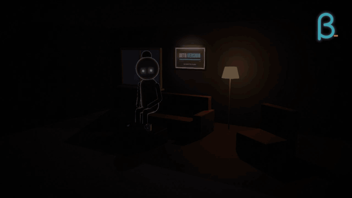

<div align="center">



# Beta Version Silhouette Studio

**Turn a story into a voiced, scored silhouette animation film (16:9 or 9:16) with code and Claude Code.**

[](LICENSE.md)
[](skill/SKILL.md)
[](https://threejs.org/)
[](https://www.instagram.com/beta_versionhq/)
[](https://www.youtube.com/@BetaVersion_HQ)

### **📣 Like it? Follow [@beta_versionhq on Instagram](https://www.instagram.com/beta_versionhq/) and subscribe on [YouTube @BetaVersion_HQ](https://www.youtube.com/@BetaVersion_HQ) for new tools and updates.**

</div>

---

## What it is
A small film studio in code. You write the story in one Python file (lines, emotions, marks, date chips). The kit then:
- **voices** every line with Kokoro-82M (free, local, Apache-2.0),
- **stages** glowing-eyed silhouette figures in a three.js set (walks, sits, looks, talk motion from the voice),
- **cuts** the camera automatically (speaker singles, wides, clean framing in both 16:9 and 9:16),
- **scores and sound-designs** it procedurally (footsteps from the animation, doors, rooms, rain, piano and strings),
- **checks** it with a QA gate (feet, walls, speed, framing, dates, voices) before anything renders,
- **renders** an mp4 at 30 fps with the browser's GPU, or on the CPU if there is none.

No paid APIs, no cloud, no sample packs.

## Quick start (3 commands)
```bash
python kit/setup.py                                # installs everything, detects your render tier
python kit/new_film.py myfilm --format short       # copies a starter film to films/myfilm
python kit/make.py films/myfilm all                # build, voice, sound, qa, render -> films/myfilm/out/myfilm.mp4
```
Needs Python 3.10+, Node 18+ and ffmpeg on PATH. Details and troubleshooting: [SETUP.md](SETUP.md).
Try `--seconds 10` on the last command for a quick first render.

## With Claude Code
Copy `skill/` into `~/.claude/skills/silhouette-studio/` (or open this repo in Claude Code) and ask:
*"Make a 90-second silhouette short about two brothers fixing an old radio."* The skill walks story, build, voice, staging,
sound, QA and render, and reads the right reference for each step.

## Render tiers
`kit/setup.py` picks the tier by testing what WebGL actually runs on; `--tier` or `TIER=` overrides it.

| Tier | What it uses | Rough speed (720p, 30 fps) | 1-minute film |
|---|---|---|---|
| `GPU` | NVIDIA GPU through installed Chrome or Edge | ~45 frames/s (laptop RTX 5070) | ~40 s |
| `ANYGPU` | any other GPU (Intel, AMD, Apple) through Chrome or Edge | usually 15-40 frames/s | 1-2 min |
| `CPU` | no GPU: Chromium headless shell with SwiftShader | ~9 frames/s (24-thread laptop CPU) | ~3-4 min |

The picture is the same on every tier. Voice (Kokoro) runs fine on a CPU: about 1-2 s per line.

## Formats
| `film.json` `"format"` | Size | Max length | For |
|---|---|---|---|
| `long` | 16:9, 1280x720 | 5 min | YouTube films |
| `short` | 9:16, 720x1280 | 2 min | Shorts, Reels, TikTok |

The cameras reframe for the format: in 9:16 speakers are framed head to knees, two-shots become singles and hand-made shots
can carry their own 9:16 version. Output: H.264 mp4, AAC 192 kbps, loudness -16 LUFS, fast start.

## Sets
| Set | Look |
|---|---|
| `room` | a living room at night: sofa, lamp, rain-dark window, door to a lit hallway |
| `motel` | a roadside motel lot at night: neon sign, sodium lamp, ice machine, desert and stars |
| `laundromat` | a coin laundromat: washers and dryers, folding table, glass door to the street |

Each set exports its doors, seats, props and light modes for staging. New sets follow the same pattern
([engine guide](kit/references/engine-guide.md)). The starter film, *The Spare Key*, uses all three.

## Layout
```
kit/
  setup.py  make.py  new_film.py  render.py  snap.py   entry points
  common/       story build, date checks, placeholder voices
  engine/       three.js page, staging, camera, QA, renderer, procedural sound
  sets/         room, motel, laundromat
  starters/     long and short starter films
  voice/        Kokoro step
  references/   engine guide, story, sound, QA, top 12 rules
skill/SKILL.md  Claude Code skill
```

## Branding
Every film carries the Beta Version wordmark as a small corner watermark, on in-world props (a poster, a sign, a mug, a box),
on the end card and in the mp4 metadata. It never covers a face or a caption. See [NOTICE.md](NOTICE.md).

## Credit
Credit appreciated: "Made with Beta Version Silhouette Studio" + link to this repo. Optional.

## Licence
Code: [MIT](LICENSE.md). Third-party parts and the brand: [NOTICE.md](NOTICE.md).
